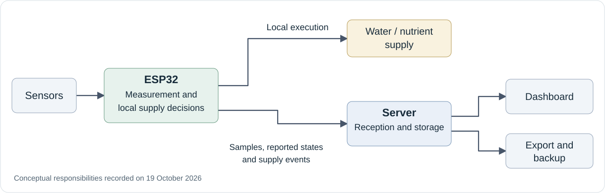

# Lysimeter Research Notes

### Building, measuring and learning from an ESP32-based lysimeter system

This notebook follows the development of a lysimeter system for MSc research: the questions behind design decisions, the problems encountered in the field, and the evidence used to evaluate changes.

The focus is on making the reasoning traceable. What changed? What was observed? What remains uncertain?

## Research purpose

My MSc work develops a lysimeter measurement and monitoring system to support plant-water research. The engineering question explored here is how mass records can remain interpretable and comparable while acquisition hardware, calibration and field conditions change. Connecting measurements with supply events and intervention records is part of that work.

## System overview

Conceptual flow based on the device-local supply transition recorded on 19 October 2026. Supply reports and backup paths need their own verification. The [architecture guide](docs/ARCHITECTURE.md) explains responsibilities and management paths.

## Start here

1. [About this notebook](ABOUT.md): research context and reading guide.
2. [Research journal](journal/README.md): design questions, field revisions and follow-up work.
3. [Methods notes](methods/README.md): measurement meaning, data quality and limitations.
4. [Revision log](revisions/README.md): candidate development, review and field application.
5. [Design decisions](docs/DESIGN_DECISIONS.md): separating valid zero from missing readings and defining the calibration boundary.
6. [My contributions](docs/MY_CONTRIBUTIONS.md): my role, professor guidance and AI assistance.

> **Documentation edition: 23 October 2026.** This repository contains research notes, documentation templates, an offline worked analysis using six transcribed reported readings, and a separate synthetic teaching example. Operational application code, firmware, full experimental datasets and field photographs are not included. Historical results below are summaries of local records; preparing this edition did not involve new operational tests.

## Recent entries

| Date | Entry | Evidence status |
| --- | --- | --- |
| 20 Oct 2026 | [Bilingual interfaces and chart export](journal/2026-10-20-bilingual-dashboard.md) | Revised candidate; deployment unconfirmed in the records reviewed |
| 19 Oct 2026 | [Moving supply decisions to the device](journal/2026-10-19-field-revision.md) | Field records and verification of a subset of records |
| 16 Oct 2026 | [Keeping the data trail intact](journal/2026-10-16-revision-questions.md) | Historical design questions |

[From a supply event to evidence of delivery](journal/from-supply-event-to-evidence-of-delivery.md), written on 21 October and published on 22 October 2026, explains the different claims supported by reports, field observations, accounted volume and direct measurement. It adds no new measurements.

## From sensor readiness to research data

[From a sensor-ready flag to usable research data](journal/2026-10-23-from-sensor-ready-to-research-data.md) was published on 23 October 2026. It separates firmware application, initialization, receipt, measurement checks and research-data selection. It releases no new measurements.

## Reference-pot design revision

[From three evaporation references to a three-role reference setup](journal/2026-10-23-three-role-reference-setup.md) was published on 23 October 2026. It explains the revised reference roles and their limitations without releasing new measurements.

## Worked analysis

[Reproducing a reference-mass check from six recorded readings](examples/l2-reference-mass-20260922/README.md) connects selected L2 record values with Python analysis, a generated summary and a figure. It reproduces the calculation, not sensor acquisition or a full calibration.

[Valid zero, missing and invalid readings](examples/valid-zero-missing-invalid/README.md) is a separate offline teaching example with explicitly synthetic inputs, a standard-library Python script and a generated figure. It demonstrates data meaning rather than sensor accuracy or operational behaviour.

## Earlier development

[From HX711 to ADS1256: learning what a mass reading means](journal/from-hx711-to-ads1256.md) is a retrospective written on 20 October 2026.

| Period | Recorded stage | What it supports |
| --- | --- | --- |
| Early configuration | HX711 plant and drainage channels | The starting measurement path |
| 19 Aug 2026 | L2 missing-sensor detection with a published zero | The need to distinguish failed readings from valid zeros |
| 14 Sep 2026 | L1 ADS1256 software integration | A revised calibration boundary; not full measurement validation |
| 18-20 Sep 2026 | Continuous operation with mixed ADC configurations | Separate assessment of collection, interventions and stability |
| 22 Sep 2026 | L2 ADS1256 reference checks | A bounded result with further checks pending at that time |

## Research questions

- How can device decisions, physical actions and stored events be traced to the same supply operation?
- How should missing measurements, failed queries and valid zero values be distinguished?
- What comparisons remain valid across hardware replacement, recalibration and manual intervention?
- What evidence shows that supply events have reached both the ledger and the backup?

These are research directions. This notebook does not establish improvements in crop performance, evapotranspiration accuracy or long-term reliability.

## Explore the system

| Topic | Contents |
| --- | --- |
| [Architecture](docs/ARCHITECTURE.md) | Boundaries between sensing, device decisions, storage and display |
| [Measurement and quality](methods/measurement-and-quality.md) | Mass, dose accounting, temperature and uncalibrated TDS indices |
| [Evidence and limitations](methods/evidence-and-limitations.md) | What different forms of verification support |
| [Repository contents](docs/REPOSITORY_CONTENTS.md) | Included documentation and future source selection |
| [Reproducibility](docs/REPRODUCIBILITY.md) | Requirements before publishing executable code |
| [Publication checklist](docs/PUBLICATION_CHECKLIST.md) | Checks for future additions |

Raw records and failure evidence are retained separately. Public entries present selected summaries. License and formal citation metadata have not yet been specified.
