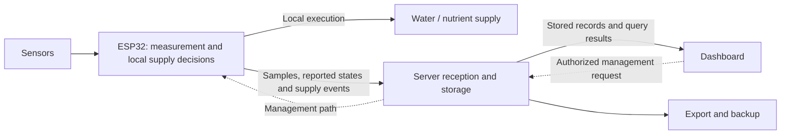

# System Architecture

This description reflects the device-local supply transition recorded on 19 October 2026. Operational application source is not included; the separate offline analysis example is published. The complete system was not reverified for this documentation update.

Solid arrows show measurement, execution, records and outputs; dashed arrows show authorized management paths. Automatic supply decisions belong to the ESP32 in this recorded structure. The diagram summarizes responsibilities rather than wiring, control parameters or a deployment specification.

A reported supply event does not establish measured delivery for every pulse. An export or backup path does not establish completion of a particular archive. [Field revision notes](../journal/2026-10-19-field-revision.md) explain the evidence boundaries, and [design decisions](DESIGN_DECISIONS.md) connect measurement meaning with the acquisition path.

## Responsibility boundaries

- **Device:** measurement, local supply decisions, execution and event reporting. An unreported active channel should not be inferred by the display.
- **Server:** reception, event storage, the ledger, queries and management paths. Keep the current structure distinct from historical server-driven supply decisions.
- **Interface:** explain values, states, timestamps and quality. Missing reports and failed queries are not normal states or zero readings.
- **Analysis:** distinguish raw, aggregated, supplemented and synthetic data. Control references and scientific estimates serve different purposes.
- **Backup:** verify preservation and restoration of specified records. Scheduler success, content verification, partial dates and complete dates are different claims.

CO2, leaf temperature, CAM and B/BV planning, installation, component tests and research readiness need their own records. Completion of a lysimeter revision does not establish integration of every related instrument.

Future server, interface and firmware publication must reconcile candidate packages with application records. The working folder, reviewed candidate and deployed version are not assumed to be identical.

[Home](../README.md) · [Evidence and limitations](../methods/evidence-and-limitations.md)
