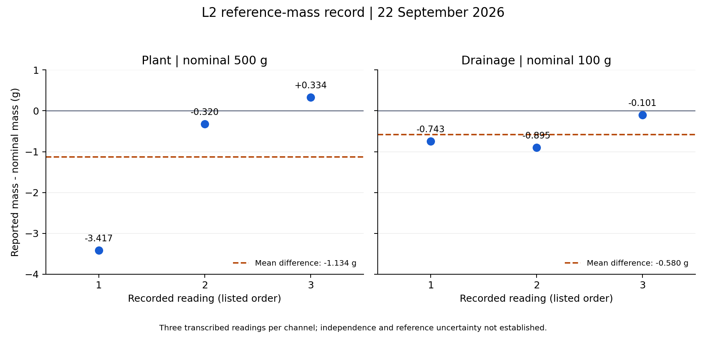

# Reproducing a reference-mass check from six recorded readings

**Record date:** 22 September 2026, Sri Lanka Standard Time  
**Analysis prepared:** 20 October 2026  
**Scope:** an offline worked analysis of reported L2 ADS1256 values.

This example connects a small measured record with executable analysis and a figure. It reproduces calculations from a transcription, rather than the sensor acquisition process. No new measurements were made for this example.

## Question and data

What are the average difference from the nominal reference mass and the spread of the three listed readings for each channel?

| Channel | Nominal mass (g) | Reported readings (g), in listed order |
| --- | ---: | --- |
| Plant | 500 | 496.583, 499.680, 500.334 |
| Drainage | 100 | 99.257, 99.105, 99.899 |

These values were transcribed from the laboratory execution table of the internal **L2 laboratory update and checklist, 22 September 2026**, specifically its Plant 500 g and Drainage 100 g rows. The source filename and data limitations are recorded in [readings.json](readings.json). The full internal report is not distributed because it also contains operational configuration. These six values are reported measurements, not synthetic fixtures or a raw telemetry export.

The source does not provide per-reading timestamps, sequence identifiers or raw ADC counts. It does not establish that the three values are independent load-and-remove trials. Its accompanying note discusses repeated display of a cloud sample and a subsequent display safeguard; that makes independence especially important to leave unclaimed.

## Reproduce the calculation and figure

Download this example folder, open a terminal in it, and use a separate Python environment:

```bash
python -m venv .venv
```

Activate it with `.venv\Scripts\Activate.ps1` in Windows PowerShell, or `source .venv/bin/activate` on macOS/Linux. Then run:

```bash
python -m pip install -r requirements.txt
python analyze.py --output reproduced
```

The script reads the adjacent JSON file and writes `reproduced/summary.json` and `reproduced/deviations.png`. It does not filter or discard any reading, and does not connect to a server or device. The published [summary.json](summary.json) and [figure](deviations.png) were generated with this script using Python 3.13.2 and Matplotlib 3.10.3 on Windows. The dependency file pins the plotting package; it is not a complete environment lockfile. The analysis command was tested in the existing environment; a fresh virtual-environment dependency installation and other operating systems were not separately tested for this publication.

Compare the reproduced summary's data hash and numerical results with the published summary. Runtime metadata can differ in another environment, and figure bytes can depend on the rendering environment. Figure labels must still show the same six differences.

## Method and results

For each channel separately, the script calculates the arithmetic mean, mean minus nominal mass, relative mean difference (`100 * difference / nominal mass`), sample standard deviation with denominator `n - 1`, and range (`maximum - minimum`). The standard deviation and range describe only the listed values. See the [NIST definitions of spread](https://www.itl.nist.gov/div898/handbook/eda/section3/eda356.htm).

| Channel | n | Mean (g) | Mean - nominal (g) | Relative difference (%) | Sample SD (g) | Range (g) |
| --- | ---: | ---: | ---: | ---: | ---: | ---: |
| Plant | 3 | 498.866 | -1.134 | -0.227 | 2.004 | 3.751 |
| Drainage | 3 | 99.420 | -0.580 | -0.580 | 0.421 | 0.794 |

Values here are rounded for display; [summary.json](summary.json) retains the computed values. The mean and difference agree with the source's rounded summary. No new acceptance threshold or pass/fail judgment is assigned.



Each point is one listed reading minus its channel's nominal mass. The dashed line is that channel's mean difference. Both panels use the same vertical scale. Reading order is not an elapsed-time axis; the plot does not show drift.

## What this example establishes

The calculations and figure can be reproduced from six explicitly identified values. All three listed drainage readings were below the nominal 100 g; the plant readings span both sides of the nominal 500 g. That observation is limited to these values.

The original record described its reference checks as passing while excluding low-load performance. This example preserves that historical context without adopting the historical verdict as a new validation result.

## Limits and next evidence

- This is one nominal mass per channel and three reported readings each. It does not establish linearity, detection limits, low-load accuracy, long-term stability or ADC superiority.
- The source does not establish independent repetitions, reference-mass uncertainty or a calibration certificate. Sample SD is not a full uncertainty estimate. [NIST's traceability policy](https://www.nist.gov/calibrations/traceability) requires a documented calibration chain with contributions to measurement uncertainty; no metrological traceability claim is made here.
- The underlying acquisition logs, environmental conditions and full loading sequence are not available in this package. Reproducing the arithmetic does not validate data acquisition.
- A future case should retain timestamped unique samples, loading/removal events, calibration version and reference documentation, and cover the small changes relevant to the experiment.

[Development context](../../journal/from-hx711-to-ads1256.md) · [Evidence and limitations](../../methods/evidence-and-limitations.md) · [Home](../../README.md)
