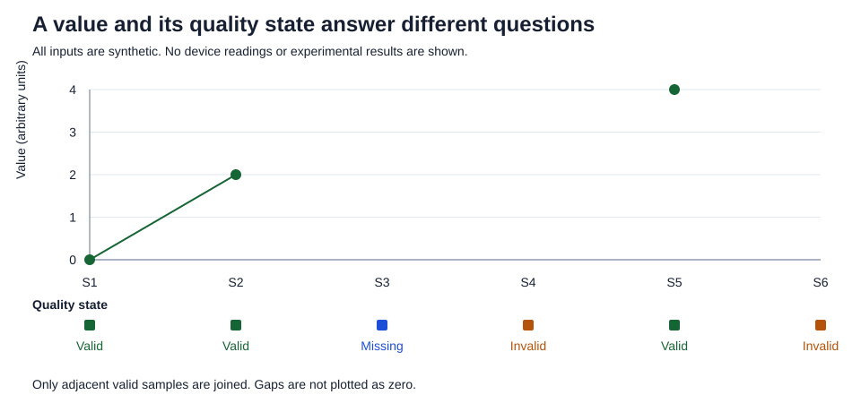

# Valid zero, missing observation and invalid reading

**Prepared:** 21 October 2026  
**Published:** 22 October 2026  
**Status:** Published synthetic teaching example; researcher review pending  
**Data:** Entirely synthetic, in arbitrary demonstration units

## The question

If a stored value is zero, does it represent a valid observation? The number alone cannot answer that question. This small example separates the numerical value from its declared quality state, following the notebook's [measurement notes](../../methods/measurement-and-quality.md#missing-data-and-aggregation) and [design decisions](../../docs/DESIGN_DECISIONS.md).

## Inputs and interpretation

[inputs.csv](inputs.csv) contains six invented rows. There are no timestamps, device identifiers or experimental measurements.

| Sample | Retained value | Declared state | Used in the valid-only mean? |
| --- | --- | --- | --- |
| S1 | 0 | valid | Yes: a valid zero is still an observation |
| S2 | 2 | valid | Yes |
| S3 | empty | missing | No observation is available |
| S4 | 0 | invalid | No: the same numerical zero has a different meaning |
| S5 | 4 | valid | Yes |
| S6 | 999 | invalid | No: retain the reported number without interpreting it as a valid value |

The states were assigned when creating this teaching dataset. The script does not discover sensor failures or define an acceptable measurement range. In particular, 999 is an arbitrary invented placeholder, not a detection threshold.

## Run locally

Use Python 3.10 or newer for the syntax in this script. Only the standard library is required. Python **3.13.2** was used for the local checks on Windows; other versions and a separate clean environment were not tested.

From this example directory:

```console
python analyze.py
```

The script reads its adjacent CSV and writes [generated/summary.json](generated/summary.json) and [generated/validity-demo.svg](generated/validity-demo.svg). It replaces only these two output files on a rerun. It has no network, database or device access. An optional `--output` directory keeps generated files separate from the input and script directories.

## Expected result

- Six rows: three valid, one missing and two invalid.
- The valid-only mean is `(0 + 2 + 4) / 3 = 2`.
- Deliberately forcing every non-valid row to zero gives `(0 + 2 + 0 + 0 + 4 + 0) / 6 = 1`.

The second calculation is included to expose a change in meaning and denominator. It is not a recommended missing-data treatment. The valid-only mean also describes only the available valid observations; it does not estimate the missing values or guarantee an unbiased research result.



Only adjacent valid observations are joined in the figure. Missing and invalid rows retain their sample positions but have no point on the value axis. Their states appear on a separate rail.

## Checks and limits

The local run produced the expected counts and means. Two consecutive runs produced identical JSON and SVG bytes. Focused checks rejected malformed status/value combinations, unknown states, non-finite values, duplicate sample identifiers, missing columns and rows not explicitly labelled synthetic. The output-directory guard was also checked. The generated SVG was rendered locally and visually checked. Its published appearance on GitHub was also visually checked on 22 October 2026.

This example demonstrates arithmetic and representation for chosen inputs. It does not validate acquisition hardware, operational software, imputation methods, field reliability or sensor accuracy. A failed database query is also distinct from a missing observation, but query handling is outside this example.

AI assisted with the code and English draft. Researcher review of the interpretation and final wording remains pending.

[Notebook home](../../README.md) · [Evidence and limitations](../../methods/evidence-and-limitations.md)
