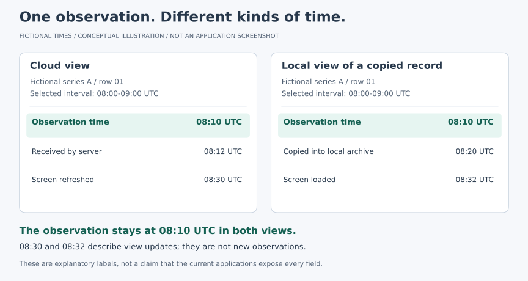

# Keeping cloud and local research views interpretable

**Drafted:** 23 October 2026  
**Published:** 23 October 2026  
**Evidence status:** Interpretation of saved software reviews and application records for the reference-pot views. The illustration is entirely fictional. No new experimental measurements are released here.

## My question

What do I need to know before comparing a cloud chart with a local chart?

While developing the reference-pot views for my MSc lysimeter project, I found that a chart's context needs as much attention as its line. I need to know where the records came from, which interval was selected and how individual readings became plotted points. Those details determine what comparison I can reasonably make.

The [earlier interface note](2026-10-20-bilingual-dashboard.md) discussed language and chart export. Here I focus on the meaning of the displayed records.

## Two views can represent different selections

In the versions reviewed for this entry, the cloud environmental chart uses a rolling time window, while the local V2 chart selects a calendar day in Sri Lanka time. The cloud chart is built from selected, latest-time batch samples, while the local view reduces exported readings to per-minute medians. The precise reduction rule also depends on the variable. A local copy carries its own source and cache context.

These are version-specific descriptions from saved reviews and source inspection. They are not a claim that every current or future screen behaves identically. To compare the views, I first need to align their inputs and processing rules.

| Context to retain | Question I need to answer |
| --- | --- |
| Source and identity | Which source, physical role, channel and variable produced the records? |
| Selected interval | Is this a rolling window or a calendar day, and which timezone defines its boundaries? |
| Reduction rule | Is each plotted point a selected reading, a median or another summary? |
| Time meaning | Does a displayed time refer to the observation, receipt, copy or screen update? |
| Coverage and status | Were records returned, was the response empty, or did the request fail? |

Differences between charts may therefore require a data-selection explanation before a biological or hardware explanation.

## Keep observation time visible

*All times and labels in this illustration are invented. It is not an application screenshot, an experimental record or a demonstration of the actual aggregation rules. The labels illustrate the context I want to establish; they do not mean that the applications currently expose every field.*

In this example, refreshing the cloud view at 08:30 UTC or loading the local view at 08:32 UTC leaves the observation time at 08:10 UTC. A recent screen update alone cannot tell me how recent the underlying observation is.

For an exported figure, I want its source, variable, units, timezone, selected period and reduction rule to remain available in the caption or accompanying record. Generating an image is one step; preserving its interpretation takes additional documentation.

## A period label must belong to its response

One concrete problem in the cloud review concerned changing the selected period while a request was still in progress. The requested interval and the current control selection could become different. A returned chart could then be read under the wrong period label.

The reviewed correction associated the response with the interval requested, discarded an obsolete response and requested the latest selection. That is a specific interface correction, supported by the saved review. It does not establish complete field-data coverage or solve every asynchronous interface problem.

## Empty, failed and interrupted need different readings

An empty successful response means that no matching records were returned within that query's scope. A failed request leaves that question unresolved. Neither should quietly become a measured zero, and a previous period's chart needs an explicit context if it remains visible.

The reviewed environmental chart paths skip missing values and break a line when the gap between plotted points exceeds their configured threshold. A shorter missing interval can still lie between connected points. I therefore cannot infer complete sampling from the appearance of a continuous line.

The local review also distinguished cloud-export/cache provenance from verified USB-source provenance. Having records available locally and verifying their source are separate checks. I need to retain that distinction when describing offline access or backup evidence.

## What the review establishes

Saved records document independent review, scoped synthetic interface checks, cloud reference-page deployment and local environmental-chart application for the versions discussed here. Those checks address defined display behaviour. Later sensor-state revisions have their own review and release history; this entry does not claim their deployment.

I did not query the live system, repeat field measurements or operate equipment while preparing this note. Operational source and logs remain private, so this is a bounded public explanation rather than a reproducible release of the applications.

The [sensor-ready note](2026-10-23-from-sensor-ready-to-research-data.md) explains the separate question of measurement eligibility. My next documentation task is to make the context of a selected chart easy to recover without treating display success as a measurement result.

My professor established the overall research direction. I developed the detailed system with AI assistance; AI also assisted this English note and its fictional illustration. The [contribution statement](../docs/MY_CONTRIBUTIONS.md) describes that support.

[Research journal](README.md) · [Home](../README.md)
